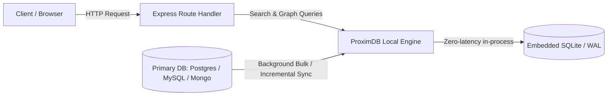

# ProximDB Architecture & Overview

ProximDB is a high-performance, plug-and-play middleware search and relationship engine tailored for Node.js and Express developers.

## The Core Philosophy: Separation of Concerns

Production web applications often experience performance degradation when heavy text searches, wildcard queries (`LIKE '%...%'`), and complex multi-join graph algorithms (such as "People You May Know" or recommendation feeds) run directly against the primary transactional database (PostgreSQL, MySQL, MongoDB).

ProximDB solves this by establishing a dedicated, zero-latency local search layer:
- **Mirroring:** Mirrors only the targeted entities, attributes, and relationships needed for search and recommendations into an embedded SQLite database (`better-sqlite3`).
- **Zero Network Overhead:** The embedded SQLite engine runs directly within the Node.js application process. Queries do not incur network round-trips to external search clusters (like Elasticsearch) or graph databases (like Neo4j).
- **Zero Configuration for End-Users:** SQLite is self-contained and file-based (or in-memory). No auxiliary daemon or external services need to be installed or maintained.

## Internal Storage Architecture

ProximDB organizes data into normalized embedded tables:

1. **`search_nodes`**:
   - Stores projected attributes in structured JSON (`attributes_json`).
   - Normalizes and tokenizes text attributes into `search_text` for fast substring and fuzzy scans.
   - Includes timestamp tracking for incremental synchronization.
2. **`search_nodes_fts`**:
   - SQLite FTS5 full-text index with trigram tokenization enabled for sub-millisecond search retrieval.
3. **`search_edges`**:
   - Stores directed and undirected relationship connections (`source_id`, `target_id`, `edge_type`, `weight`).
   - Indexed across source, target, and composite keys for recursive pathfinding queries.
4. **`sync_metadata`**:
   - Tracks sync checkpoints, timestamps, and item counts per entity and edge type.
